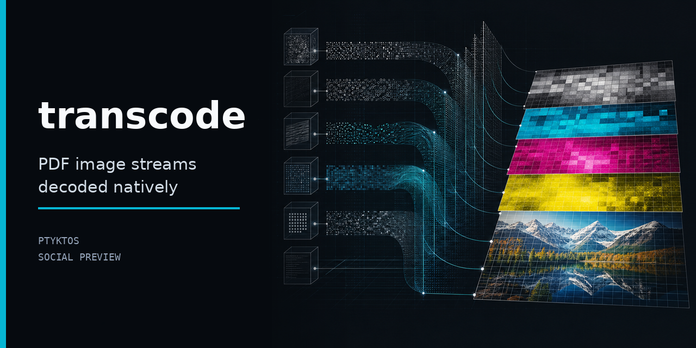

# transcode



**Zero-dependency PDF image decoder.** Extract and decode image streams from PDF files.
Pure Rust, std only — no libc, no ffmpeg, no C libraries.

Used by [pdffold](https://github.com/Ptyktos/pdffold) for image extraction during
PDF-to-markdown conversion. Sovereign from-scratch JPEG and PNG codecs handle the
image formats embedded in PDF content streams.

## Quick start

```toml
[dependencies]
transcode = "0.1"
```

```bash
cargo build --release
```

Decode images from a PDF via the CLI:

```bash
# Extract + decode all JPEG and PNG image streams to RGBA
transcode extract in.pdf --out-dir ./frames

# Pipe raw image stream bytes from a PDF object
cat obj-stream.bin | transcode decode --fmt auto > decoded.rgba
```

## Features

- **JPEG decode** — baseline sequential DCT, Huffman entropy coding (no arithmetic,
  no progressive). Grayscale + YCbCr with arbitrary sampling factors (4:2:0, 4:2:2,
  4:4:4), restart markers. Output is canonical 8-bit RGBA.
- **PNG decode** — all color types (grayscale, RGB, palette, gray+alpha, RGBA),
  8-bit depth, non-interlaced. Full DEFLATE inflate (stored / fixed-Huffman /
  dynamic-Huffman) + zlib wrapper + scanline filters.
- **Zero dependencies** — from-scratch implementations of JPEG DCT/Huffman, PNG
  DEFLATE/CRC-32/Adler-32. No libpng, libjpeg, zlib, or system libraries.
- **Container probes** — parse stream headers without full decode (dimensions,
  color type, compression params).
- **RGBA canonical output** — both codecs produce the same `Image` struct (`Vec<u8>`
  RGBA pixels, width, height), so downstream consumers handle one format.

## How it works

PDF files embed image streams as compressed object data, typically JPEG DCT or PNG
deflate. transcode provides the decode engines for both formats:

- **JPEG path:** Parse SOI–EOI markers, extract quantization + Huffman tables,
  decode MCU blocks via separable DCT, upsample chroma components to full
  resolution, output RGBA.
- **PNG path:** Parse chunk stream (IHDR → IDAT → IEND), inflate DEFLATE-compressed
  scanline data (dynamic or fixed Huffman), reverse the per-scanline filter (none,
  sub, up, average, Paeth), assemble RGBA pixels.

Both codecs are standalone implementations — no wrappers around system libraries,
no FFI, no `build.rs` probes. The JPEG decoder uses a clean direct separable float
DCT (AAN/FFT fast path available as a drop-in); the PNG decoder includes a complete
DEFLATE inflate with LZ77 hash-chain match finding.

```
PDF object ──▶ JPEG marker scan ──▶ Huffman decode ──▶ iDCT ──▶ RGBA pixels
             or
             ▶ PNG chunk parse ──▶ DEFLATE inflate ──▶ unfilter ──▶ RGBA pixels
```

## Library API

```rust
// Decode JPEG bytes → RGBA image
let img = transcode::jpeg::decode(&bytes)?;

// Decode PNG bytes → RGBA image
let img = transcode::png::decode(&bytes)?;
```

Both return `Image { width: u32, height: u32, pixels: Vec<u8> }` where `pixels`
is RGBA8, row-major, `width * height * 4` bytes.

## Related Projects (Ptyktos ecosystem)

- **[pdffold](https://github.com/Ptyktos/pdffold)** — PDF-to-markdown using transcode
  for image stream extraction
- **[swarm](https://github.com/TWN-Systems/swarm)** — swarm prediction via
  stationary-phase collapse
- **[talon](https://github.com/TWN-Systems/talon)** — mail-security adapter on the
  same collapse engine
- **[cerealize](https://github.com/TWN-Systems/collapse_wire)** — zero-dependency
  Rust serialization via the x=B/U Null residual
- **Sanguine** — the Lean proof corpus; the fixed-point kernels in this crate derive
  from `proof/PolyphaseCollapse.lean` and `proof/IIRFilterCollapse.lean`

Also from the fold-family: **[chunkfold](https://github.com/Ptyktos/chunkfold)**,
**[textfold](https://github.com/Ptyktos/textfold)**,
**[webfold](https://github.com/Ptyktos/webfold)**,
**[sdirstat](https://github.com/Ptyktos/sdirstat)**.

## License

MIT

Sovereign, ffmpeg-free audio + image codec crate — pure Rust, zero
non-Ptyktos dependencies.

## What it is

transcode is the Ptyktos fold-extracted codec layer. PNG, JPEG, AAC, AV1,
H.264, FLAC, MP3, MP4, HEIF, WEBP, NIfTI, HDF5 — all decoded and encoded
without leaving the ptyktos substrate (no ffmpeg, no libpng, no libjpeg).

Lives on the ptyktos substrate because Ptyktos's image + audio pipelines
(`memoryfold`, the audio-folders, the `glossa` localization engine, the
peregrine-ng extraction service) all want to handle media without
shipping ffmpeg.

## What lives here

| Surface | Path |
|---|---|
| Crate | `src/lib.rs` |
| PNG decoder/encoder | `src/codec/png/` |
| JPEG decoder/encoder | `src/codec/jpeg/` |
| AAC decoder/encoder | `src/codec/aac/` |
| AV1 decoder/encoder | `src/codec/av1/` |
| H.264 decoder/encoder | `src/codec/h264/` |
| MP4 muxer | `src/mp4/` |

## Build

```sh
cargo build --release
```

## See also

- [`Ptyktos/sangsec`](https://github.com/Ptyktos/sangsec) — uses transcode
  for embedded-image inspection in agent tool calls
- [`Ptyktos/glossa`](https://github.com/Ptyktos/glossa) — uses transcode
  for localization-asset hashing

## License

SPDX: `MIT OR Apache-2.0`. Ptyktos substrate (fold-extracted).

The full Ptyktos substrate (PNG, JPEG, AAC, AV1, H.264, FLAC, MP3,
MP4, HEIF, WEBP, NIfTI, HDF5) is built and consumed by Ptyktos itself
via fold extraction; transcode exposes the image + audio halves as the
pde-aligned public surface.
